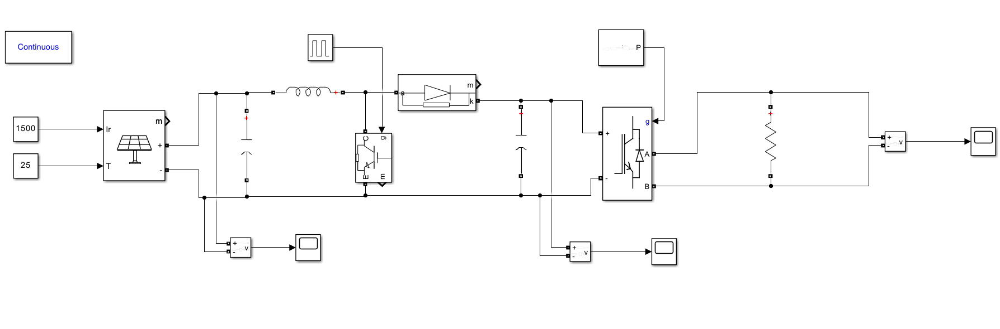
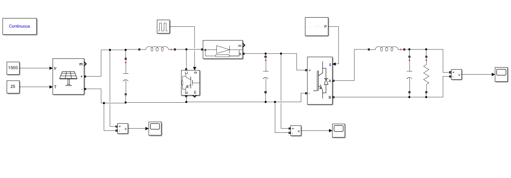

# Solar PV Power Generation System — MATLAB/Simulink

A project modelling a solar photovoltaic (PV) power-generation system in MATLAB/Simulink R2024a.

## Project Overview

The model uses irradiance (`Ir`) and temperature (`T`) inputs for a PV array. The generated DC power passes through a DC–DC boost-converter stage and DC-link capacitor, then an inverter/bridge supplies a load. Two configurations are considered:

- **Without output passive filter**
- **With output passive filter (inductor and capacitor)**

The project compares the voltage waveforms before boosting, after boosting, and at the inverter output. The supplied results indicate that the output waveform with the passive filter is smoother and more sinusoidal than the unfiltered switching waveform.

## Repository Contents

Suggested repository structure:

```text
solar-pv-power-generation-simulink/
├── README.md
├── model/
│   ├── Solar_PV_Power_Generation_System(without passive filter).slx
│   └── Solar_PV_Power_Generation_System(with Passive Filter).slx
├── report/
│   └── Solar_Power_Generation_Completed_Report.pdf
├── results/
│   └── Results & Graphs.pdf
└── screenshots/
    └── Simulink model and Scope screenshots
```


## Project Objectives

- Model a solar PV power-conversion system in MATLAB/Simulink.
- Study the effects of irradiance and temperature on PV generation.
- Examine DC–DC boost conversion and DC-link behaviour.
- Observe inverter output voltage waveforms.
- Compare output voltage with and without a passive filter.
- Document model behaviour using simulation plots.

## System Description

1. **PV Array:** Converts solar irradiance into DC electrical power. The model inputs are irradiance (`Ir`) and temperature (`T`).
2. **Boost Converter:** Uses an inductor, controlled semiconductor switch, and diode to increase the DC voltage.
3. **DC-Link Capacitor:** Stores energy and helps reduce DC-link voltage variations.
4. **Inverter/Bridge:** Converts DC power into AC power for the load.
5. **Passive Output Filter:** The filtered configuration uses an inductor and capacitor to attenuate high-frequency switching components.
6. **Measurement Blocks and Scopes:** Observe the voltage before boosting, after boosting, and at the output.

For an ideal boost converter operating in continuous-conduction mode:

`Vout = Vin / (1 − D)`

where `D` is the switch duty ratio. This is an ideal relationship; actual results can differ because of losses and operating conditions.

## Simulation Conditions

The supplied model screenshot shows:

- Irradiance: **1500 W/m²**
- Temperature: **25°C**
- Software: **MATLAB/Simulink R2024a**

Also test at **1000 W/m² and 25°C** as a common reference condition. Record the actual PV module configuration, boost inductance, capacitance, switching frequency, duty ratio, inverter settings, filter values, load, solver, and stop time from the model.

## Results Summary

### Without Output Passive Filter

- The pre-boost voltage plot appears nearly constant over the displayed interval.
- The post-boost voltage plot shows dense switching-related variation.
- The inverter output contains visible positive and negative switching pulses rather than a smooth sinusoid.

### With Output Passive Filter

- The pre-boost voltage rises quickly and then remains nearly steady in the displayed interval.
- The post-boost voltage shows a startup transient that decays toward a steady value.
- The output voltage appears smoother and approximately sinusoidal compared with the unfiltered output.

These are qualitative observations from the supplied plots. Efficiency, RMS voltage, ripple, settling time, and total harmonic distortion (THD) should be calculated only from actual simulation data.

## Recommended Validation Tests

| Test | Irradiance | Temperature | Purpose |
|---|---:|---:|---|
| Baseline | 1000 W/m² | 25°C | Record reference waveforms |
| Lower irradiance | 500 W/m² | 25°C | Observe changes in PV current and available power |
| Higher irradiance | 1200 W/m² | 25°C | Observe changes in PV current and available power |
| Temperature variation | 1000 W/m² | 50°C | Observe PV voltage and power response |
| Filter comparison | Same conditions | Same conditions | Compare inverter output with and without the passive filter |
| Load variation | Same conditions | Same conditions | Observe the effect of load changes |

Change one condition at a time and record the model settings used for each test.

## How to Run

1. Open MATLAB/Simulink R2024a or a compatible release with the required libraries.
2. Open the `.slx` model for the configuration you want to test.
3. Check the block parameters, switching/control signals, solver settings, and simulation stop time.
4. Run the simulation.
5. View the voltage measurement signals in the Scope blocks.
6. Export the Scope data if you want to calculate RMS voltage, ripple, power, efficiency, or THD.
7. Repeat using the same conditions for both filter configurations to make a fair comparison.

## Limitations

- The supplied plots do not provide sufficient numerical data to calculate efficiency, RMS values, ripple, or THD.
- The model has not been documented as grid-connected.
- Do not describe the system as using MPPT or closed-loop DC-link regulation unless those functions are present in the actual model.
- Device losses, parasitic elements, and thermal effects depend on the blocks and parameters used.

## Future Improvements

- Implement and compare Perturb and Observe (P&O) or Incremental Conductance MPPT, if not already present.
- Add closed-loop DC-link voltage regulation.
- Compare converter efficiency under different irradiance, temperature, and load conditions.
- Include realistic switching losses and parasitic elements.
- Evaluate output THD and optimise passive-filter values.
- Explore battery storage or a grid-connected inverter after validating the current model.

## Tools and Technologies

- MATLAB/Simulink R2024a
- PV array and power-electronics simulation blocks
- DC–DC boost converter
- Inverter/bridge
- Passive LC output filter
- Voltage measurement and Scope blocks

## References

1. MathWorks, “PV Array,” *Simulink Documentation*. https://www.mathworks.com/help/sps/powersys/ref/pvarray.html
2. MathWorks, “Boost Converter,” *Simscape Electrical Documentation*. https://www.mathworks.com/help/simscape-electrical/ref/boostconverter.html
3. MathWorks, “Powergui,” *Simulink Documentation*. https://www.mathworks.com/help/sps/powersys/ref/powergui.html
4. MathWorks, “Measurements,” *Simscape Electrical Documentation*. https://www.mathworks.com/help/sps/measurements.html
5. MathWorks, “Build and Simulate a Simple Circuit Using Specialized Power Systems,” *MATLAB & Simulink Documentation*. https://www.mathworks.com/help/sps/powersys/ug/building-and-simulating-a-simple-circuit.html

## Project Screenshots

### Simulink Models





### Voltage Before and After Boosting

.png.png)

.png.png)

.png.png)

.png.png)

### Output Waveforms

.png.png)

.png.png)

## Author

**Aditya Dhing**  
Electrical Engineering  
Nirma Institute of Technology
